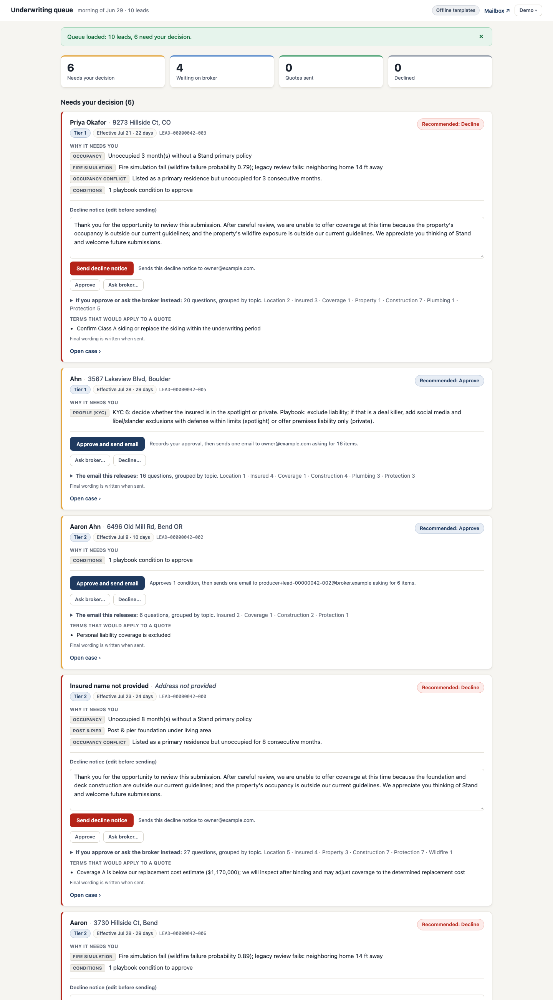

# Stand underwriting assistant (proof of concept)

This is a proof of concept for Stand's underwriting take-home. It takes a morning queue of about ten messy property leads and moves each one to a single next step: a quote, one follow-up email to the broker, or one decision card for an underwriter.

A deterministic engine reads the FigJam playbook and decides what has to happen. A Claude agent writes the emails and the underwriter briefs. Code checks every message before it is sent. The underwriter reviews before any email goes out on a certain decline, a judgment call, or a playbook condition, and nothing adverse is sent without a click.

On the seed-42 queue the assistant sends 4 follow-ups, opens 6 underwriter cards, and quotes nothing on arrival. After one round of simulated broker replies, 4 leads are quoted. The six safety gates in the eval harness are all zero, offline and with the live model. The results are in [docs/evals.md](docs/evals.md), including the limits of a 10-lead gold set.

## Run it

You need Docker, [uv](https://docs.astral.sh/uv/), and free ports 8081, 8025 and 8090 (`make ports` checks).

```bash
make setup      # install Python dependencies
make demo       # start the harness, process the seed-42 queue, serve the board
```

Then open http://127.0.0.1:8090. Without an API key, `make demo` runs offline: the wording comes from templates, and the engine and checks are the same as in live mode. The mock inbox where sent email lands is at http://127.0.0.1:8025.

To run everything in containers instead, with no local Python: `docker compose up --build`, open the board, and choose **Demo → Run morning queue**.

The Demo menu, top right of the board, has three actions: Run morning queue (seed 42 by default), Simulate broker replies (answers every open follow-up the way a broker would, so you can watch leads turn into quotes), and Start over (clears the demo's leads and empties the mock mailbox).

To use the live model, copy `.env.example` to `.env`, add `ANTHROPIC_API_KEY`, and run `make check-llm` to confirm the key works. With a key present, `make demo` and `docker compose up` run live on `claude-opus-5-5`. Set `UW_OFFLINE=1` to force offline mode. `UW_AUTOSEND_DISABLED=1` is the kill switch: every follow-up becomes an underwriter card instead of sending.

Other commands: `make test` (91 tests, a few seconds), `make eval` and `make eval-live` ([docs/evals.md](docs/evals.md)), `make screenshots`, `make down`, `make reset`.

## What happens to a lead

1. The engine joins the lead to the field registry, fills system-owned gaps from stubbed data sources, applies the FigJam defaults, and runs the 12 decision trees. If a lead declines on every possible answer to its missing questions, it asks nothing and goes straight to the underwriter.
2. The result is an assessment: what to ask, what conditions apply, what the underwriter must weigh in on, and which actions are allowed.
3. If anything needs the underwriter, they review first. The card shows the email that would go out and the terms that would apply. One click approves, asks the broker an extra question, or declines.
4. The agent picks exactly one of four tools (`send_followup`, `request_uw_decision`, `mark_quote_ready`, `send_decline_notice`) and writes its text.
5. Preconditions, content checks and an LLM moderation check run before anything is sent. If a message is rejected, the agent revises twice, then a template is used, then the underwriter takes over.
6. Each lead gets at most one email per round, and that email carries everything. Broker replies are read by a separate parser with no tools and trigger a new run.

Leads are worked Tier 1 brokers first, then by effective date.



## The documents

| Read | For |
|---|---|
| [docs/architecture.md](docs/architecture.md) | How it works, why it is built this way, the guardrails and the auto-send trade-off, the five product decisions, how I read the playbook, and what fails how |
| [docs/evals.md](docs/evals.md) | How quality is measured, the results, what the queue looks like, the iteration plan, and the prioritized list of what to build next |
| [docs/ui.md](docs/ui.md) | The underwriter board, with screenshots |
| [docs/figjam/](docs/figjam) | The playbook pages, as exported from the FigJam |
| [policies/communication_policy.md](policies/communication_policy.md) | The outbound communication policy, loaded into the agent and the moderator |

## Layout

```
src/uwagent/    engine, agent, guardrails, board (see docs/architecture.md)
evals/          eval harness, gold labels, red-team emails, saved results
tests/          91 tests
scripts/        fixture capture, live-model check, screenshots, queue measurement
policies/       outbound communication policy
sim-harness/    the provided lead generator and mock mailbox, unmodified
```

## Not built

Third-party data is stubbed (CRM, protection class, replacement cost, fire simulation, terrain, imagery, roads, KYC). There is no real email, authentication, follow-up timers, undo window before send, research agent, attachment reading, or rating. The [build-next list](docs/evals.md#what-i-would-build-next) puts them in order, and [architecture.md](docs/architecture.md#what-is-not-built) says what each would take. Weaknesses I know about in what is built (stale data, late replies, audit gaps and others) are in [known gaps](docs/architecture.md#known-gaps).
