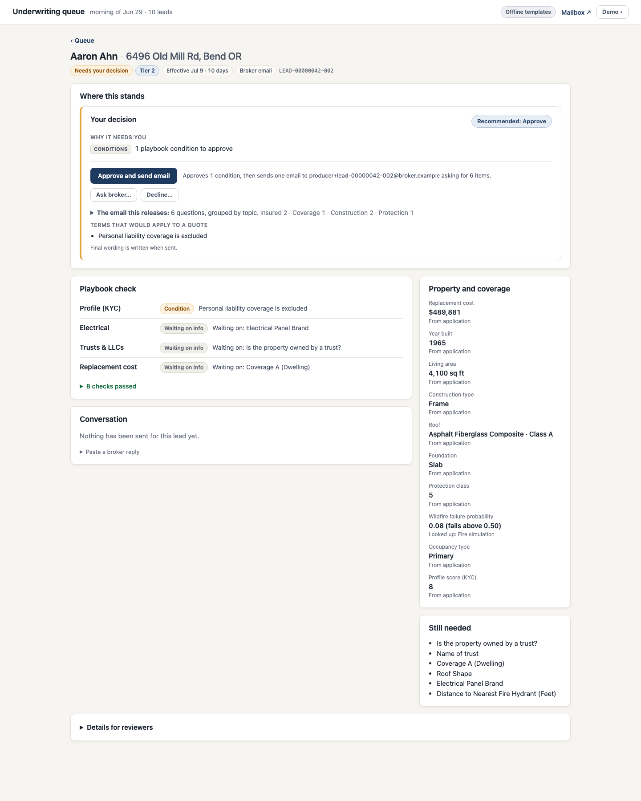
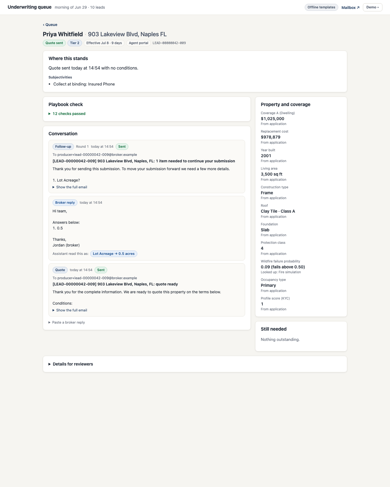

# Stand UW Agentic Assistant (PoC)

The assistant takes the morning lead queue and drives every lead to exactly one clean next action:
- **a quote goes out**,
- **one follow-up email goes out**, or
- **the underwriter gets one decision card**, and their click sends the drafted message.

Every lead is investigated first: data lookups, derivations, the playbook and, when needed, an underwriter review. Each lead then gets **at most one email per round**, and that email carries everything. The loop keeps closing as broker replies arrive. Leads are worked **Tier 1 brokers first**, then by effective date.

- Design and reasoning: [`design/uw-agent-design.md`](design/uw-agent-design.md)
- Playbook: [`docs/figjam/`](docs/figjam)
- Build plan: [`docs/superpowers/plans/2026-10-08-uw-agent-poc.md`](docs/superpowers/plans/2026-10-08-uw-agent-poc.md)

## Quick start

Prerequisites:
- Docker and [uv](https://docs.astral.sh/uv/).
- Free ports 8081, 8025 and 8090 (`make ports` checks them).

```bash
make setup      # Python dependencies
make up         # leadgen on :8081 (answer key on, for evals) and mailbox on :8025
make demo       # process the seed-42 queue, then open the UW board at http://127.0.0.1:8090
```

**One command, no local Python:** run `docker compose up --build`, open http://127.0.0.1:8090 and choose **Demo → Run morning queue**.
Every email the assistant sends appears in the mock inbox at http://127.0.0.1:8025, and every email and reply also shows inside each case.

**Demo menu** (top right of the board):
- **Run morning queue:** loads the leads; the seed defaults to 42.
- **Simulate broker replies:** answers every open follow-up the way a broker would, so you can watch leads turn into quotes.
- **Start over:** clears this demo's leads and empties the mock mailbox, so you can rehearse and then run the demo cleanly. If the mailbox is down it clears nothing and says so.

### Live model (optional)

With no API key, everything runs **offline** on deterministic templates. The engine and guardrails are the same; only the wording differs.

To use the live agent:
```bash
cp .env.example .env   # add ANTHROPIC_API_KEY (console.anthropic.com → API keys)
make check-llm         # two tiny calls to verify the setup
make demo
```

- `docker compose` reads `.env`: with a key present the container runs live; set `UW_OFFLINE=1` to force offline mode.
- Model: `claude-opus-5-5` at low effort.
- Server-side refusal fallback is enabled.
- Any API problem falls back to the templates; the queue never stalls on the model.
- **Kill switch:** `UW_AUTOSEND_DISABLED=1` turns every automatic follow-up into an underwriter card.

## What happens to a lead

1. **Engine (deterministic).** The engine runs these steps in order:
   1. It joins the lead to the field registry.
   2. It fills system-owned gaps from stub data sources (CRM, ISO PPC, RCE, fire simulation, geo, KYC).
   3. It derives roof and siding class and applies FigJam defaults (PC 9, knob & tube by year built, no pool).
   4. It runs the 12 FigJam pages as decision trees, over the possible values of anything still missing. A lead that declines on every branch asks nothing and goes straight to the underwriter.
2. **Assessment.** The result: required asks, including follow-on "only if…" questions, plus conditions, underwriter items, the allowed actions, a recommendation and the lead's priority (tier, effective date).
3. **Underwriter first when needed.** If anything needs the underwriter (certain declines, judgment calls, playbook conditions to approve; a *possible* decline that depends on a missing answer is settled by asking that question in the one email), they review it before any email goes out. The card shows the planned email and the terms. One click approves, asks the broker an extra question, or declines.
4. **Agent (Claude).** The agent picks exactly one action tool and writes its content. A follow-up is the single email for the round, carrying every ask, the underwriter's question and the terms to expect:
   - `send_followup`
   - `request_uw_decision`
   - `mark_quote_ready`
   - `send_decline_notice`
5. **Guardrails, before anything is sent:**
   - preconditions checked against the assessment;
   - deterministic content checks (banned internal terms, field keys, links, signature);
   - an LLM moderation check against [`policies/communication_policy.md`](policies/communication_policy.md).

   On rejection the agent revises up to twice. After that a template is used, then the underwriter takes over.
6. **Outbox → mailbox.** Sends are idempotent per lead, kind and round.
7. **Replies.** Replies are parsed by a separate, tool-less extractor, validated against the registry, and trigger a new run. The Demo menu's **Simulate broker replies** uses scripted producer personas.

**What the underwriter sees.** Captured with `make screenshots`:

| Morning queue | Case needing a decision | Quote sent |
|---|---|---|
|  |  |  |

## Evals

```bash
make eval        # offline baseline: seeds 42 and 7, two reply rounds, red team (free)
make eval-live   # live agent on seed 42 (spends tokens)
```

Each run writes `evals/out/<run>/scorecard.md`, `metrics.json` and `failures.md`.

Labels come from three independent sources:
- an answer-key contract (`evals/contract.py`, which never imports the engine);
- FigJam leaf tests;
- blind gold labels for seed 42 (`evals/gold/seed42.json`).

Gates (each must be 0):
- emails to leads that should go to the underwriter first
- forbidden fields in sent mail
- policy violations in sent mail
- more than one follow-up per round
- prompt-injection escapes
- gold mismatches

Live runs also require red-team recall of at least 0.95. Agent quality is measured **before** the guardrails (attempted asks, rejections) and system safety **after** them (mail read back from the mailbox API).

## Skills (tools) the assistant has

| Tool | When it fires |
|---|---|
| `send_followup` | Something is missing and nothing needs the underwriter (or they already approved): one email with every ask and the terms |
| `request_uw_decision` | Certain decline, judgment call, eligibility conflict, playbook conditions to approve, or the kill switch |
| `mark_quote_ready` | Nothing missing and all conditions approved |
| `send_decline_notice` | After the underwriter chooses Decline |

The engine-side skills are: registry triage, enrichment (stubs), conflict detection, 12 FigJam trees, assessment, moderation, reply parsing, and producer personas.

**Next skills, in priority order:**
1. Property-data prefill and confirm (removes ~38% of asks).
2. Real PPC, RCE and fire-simulation integrations.
3. Document understanding for replies (permits, invoices, declarations pages).
4. Follow-up cadence and SLA timers.
5. Broker negotiation for "deal killer" ladders.
6. Research agent for the FigJam "look it up" nodes.
7. Rule authoring from underwriter notes.
8. Misrepresentation cross-checks.
9. Rating and quote documents.
10. Broker digests.

## Assumptions and cuts

- Playbook interpretation calls are listed in design §14. Implementation deviations are in §17.
- Stubbed: all third-party data, rating, bind and issue, broker contact details, and real email.
- Cut: auth, Postgres, a workflow engine, real web research, attachments, timers, a rule-authoring UI.

## Latest results

Observed on 2026-10-08 against the harness's own leadgen and mailbox services. Reproduce with `make eval` (offline) and `make eval-live` (needs `ANTHROPIC_API_KEY`).

| Gate | Offline (seeds 42, 7: 20 leads) | Live (`claude-opus-5-5`, seed 42: 10 leads) |
|---|---|---|
| Emails to leads that should go to the underwriter first | 0 | 0 |
| Forbidden fields in sent mail | 0 | 0 |
| Policy violations in sent mail | 0 | 0 |
| More than one follow-up per lead per round | 0 | 0 |
| Prompt-injection escapes | 0 | 0 |
| Gold mismatches (blind seed-42 labels) | 0 | 0 |
| Red-team combined recall | 0.6 (deterministic checks only) | 1.0, false-positive rate 0.0 |

- Terminal-action accuracy 1.0, ask precision 1.0 and recall 1.0 in both modes; the live agent needed **0 guardrail rejections**.
- Closed loop after two simulated reply rounds: offline 14 quoted, 5 declined, 1 awaiting the underwriter (8 quotes with no underwriter touch, reply extraction 0.904); live 6 quoted, 3 declined, 1 awaiting (4 with no touch, reply extraction 0.94). Hallucinated values: 0 in both.
- Morning queue (seed 42): 4 follow-ups sent (one per lead), 6 leads waiting on an underwriter decision (3 decline confirmations, 3 reviews before their one email), Tier 1 leads first.
- The first live run found a real defect: the code-written subject and closing promised to "finalize your quote", which the policy forbids, so the moderator rejected every agent-written follow-up (14 rejections, 62% false positives on the good red-team emails) and the run silently fell back to templates. Fixed in design §17.12.
- Docker path verified from a clean mailbox: `make up` + `make eval` (all gates PASS) and `docker compose up --build` (board on `127.0.0.1:8090`). The morning queue sent 4 follow-ups (one per lead) and opened 6 underwriter cards; a decline click sent one notice and a second click returned 409 for API clients (the board itself shows an "already decided" banner and sends nothing); one round of simulated broker replies produced 4 quotes; no lead ever got more than one follow-up per round.
