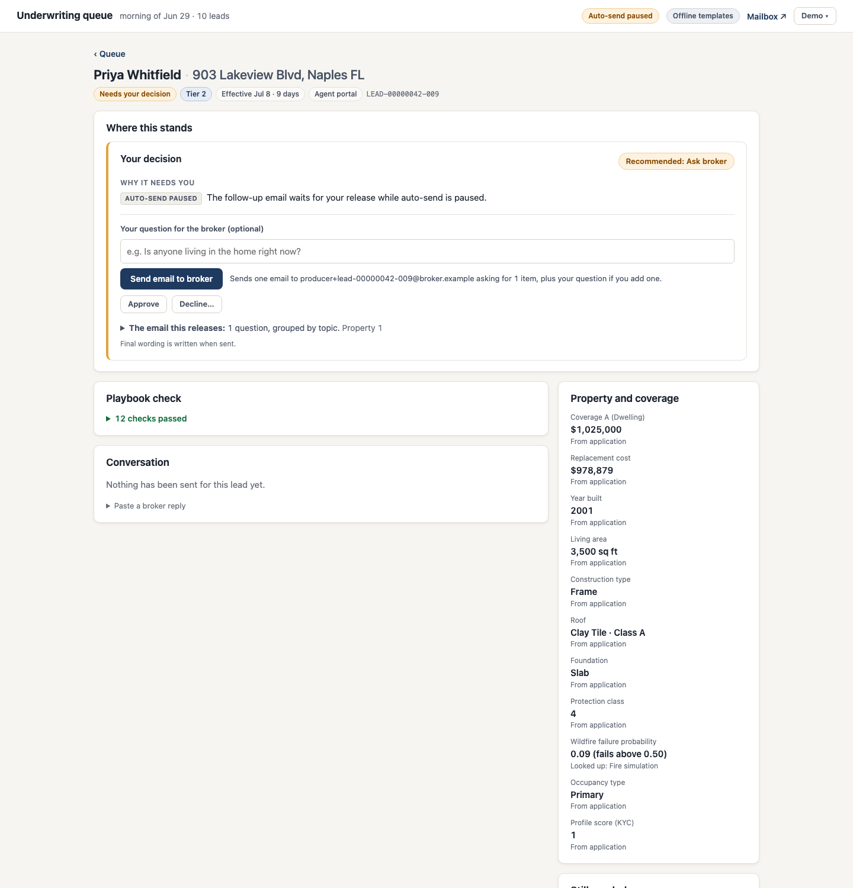
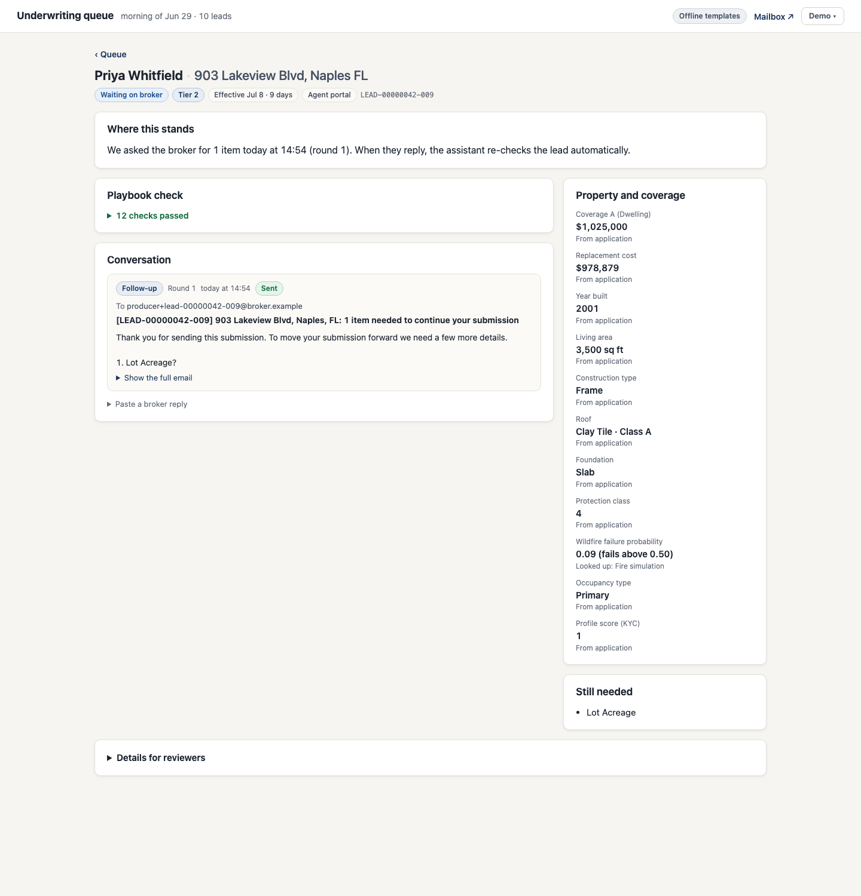
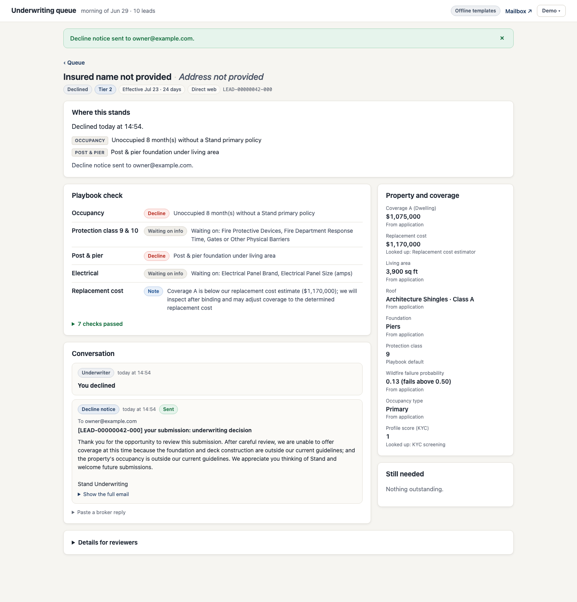
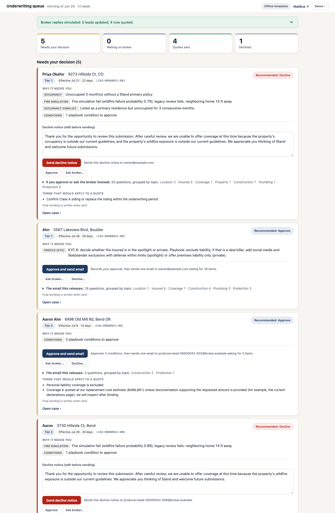

# The underwriter board

The board is where an underwriter sees what the assistant did and decides what it can't. It runs at http://127.0.0.1:8090 and is server-rendered: FastAPI, Jinja templates, one stylesheet and about 40 lines of JavaScript. There is no build step and no extra service.

I redesigned it after the first version, which worked but read like a debugging page: raw field keys, state names like `AWAITING_UW`, and buttons whose effect you had to guess. The test I used for the redesign was whether a reviewer watching a demo can tell, without explanation, what each lead needs, what the assistant already did, and what a click will do.

## The queue

The queue shows four counts (needs your decision, waiting on broker, quotes sent, declined), then the decision cards, then a table of every lead. Everything is in priority order: Tier 1 brokers first, then the nearest effective date. A lead's title is the insured's name and the property address, with the lead ID in small type. A missing name or address says so ("Insured name not provided") instead of leaving a blank.

The header carries a link to the mock mailbox, a badge that says whether the agent is live (with the model name) or running offline on templates, a notice if auto-send is paused, and the Demo menu.

## The decision card

Each card answers three questions in the order an underwriter asks them.

**Why does this need me?** One to three reasons, each tagged with the playbook page it came from (Occupancy, Fire simulation, Post and pier). Internal tokens are rewritten: "P(F) 0.79" appears as "wildfire failure probability 0.79". If the agent wrote a short brief for the card it shows as one muted line; template-written cards don't show it.

**What does the assistant recommend?** A badge (Decline, Approve, Ask broker, or Needs review) and one prominent button for that choice. Under the button is a sentence saying exactly what a click does, for example "Approves 1 condition, then sends one email to the producer asking for 6 items." The other two choices are quieter buttons that open a panel inline. Nothing is sent until the panel's own submit button is pressed.

**What goes out?** "The email this releases" shows the number of questions grouped by topic (Insured 2, Coverage 1, Construction 2) and expands to the full list. Below it are the terms that would apply to a quote, with a note that the final wording is written when sent. On a decline card the notice text is an editable box, pre-filled, so the underwriter can change it before it goes.

The Ask broker panel has a question field. It is required when there is nothing else to ask, because an "ask the broker" click with nothing to ask must not turn into a quote. The server enforces the same rule.

## The case page

The top panel, "Where this stands", changes with the lead's state. When the lead needs a decision it holds the decision card. When it is waiting on a broker it says what was asked, when, and that the assistant will re-check on its own once a reply comes in. Quoted and declined leads show what was sent and to whom.

Below that, the main column has the playbook check and the conversation. The playbook check lists the twelve FigJam pages. Pages that aren't a pass come first, each with a badge (Decline, Needs your judgment, Condition, Note, Waiting on info) and one line of reason. Passes fold into "8 checks passed". The conversation is a single thread sorted by time: the emails sent, the broker's replies with what the assistant read from each ("Assistant read this as: Roof Replacement Year → 2015"), and the underwriter's own decisions.

The side column lists key facts with their source (From application, Looked up: Fire simulation, Broker reply round 1, Playbook default) and the items still needed. A collapsed "Details for reviewers" section at the bottom holds everything else: every fact, the agent's tool calls with their results, and the event timeline. Raw field keys appear only there.

| Waiting on broker | Quote sent | Declined |
|---|---|---|
|  |  |  |

## Wording and display rules

- Every status has a text label. Colour is never the only signal. The states read Queued, Working, Needs your decision, Waiting on broker, Quote sent and Declined.
- Money is `$1,025,000`, booleans are Yes and No, and measurements carry units (`2,400 sq ft`, `543 ft`, `4.2 mi`).
- Dates show a relative part ("Jul 8 · 9 days", or "3 days ago" in red). Days are counted from the queue's morning, the earliest received date among the loaded leads, so a demo stays sensible whatever today's date is. Timestamps elsewhere are shown in the browser's local time, with a UTC label if JavaScript is off.
- Field labels come from the registry. The visual system is a set of CSS custom properties in one block, and a test checks that the text and background pairs meet WCAG AA contrast.

## Demo menu, banners and errors

The Demo menu has three actions: **Run morning queue** (with a seed field, default 42), **Simulate broker replies** (answers every open follow-up the way a broker would), and **Start over** (clears this demo's leads and empties the mock mailbox so a rehearsal doesn't leak into the real run). Start over empties the mailbox first, so if the mailbox is down it clears nothing and says so.

After every action the page shows a dismissible banner that describes what actually happened, read from the stored state, not from what was attempted: "Approved. One email asking for 6 items went to producer+lead-00000042-002@broker.example", "Decline notice sent", "Broker replies simulated: 4 leads updated, 4 now quoted". If the mailbox didn't answer, the banner says the email is queued and will be retried; it stays in the outbox until a later queue run delivers it.

Form posts from a browser get friendly errors as banners: the decision was already made and no second email was sent, the question is missing, the seed isn't a number. Other clients (curl, tests) get plain 400, 404 and 409 responses.

## How it is built

- `presenters.py` holds pure functions and the mapping tables: status labels, value formatting, source labels, page names, banner text.
- `views.py` assembles each page's data from the service and the presenters.
- `web.py` has the routes. Every decision form posts to the same `POST /cards/{id}` endpoint the API always had.
- Templates are in `src/uwagent/templates/` (`base`, `queue`, `case`, and partials for the card and email), and the stylesheet and script are in `src/uwagent/static/`.
- The script does three things: dismisses banners, opens the Ask broker panel after a missing-question error, and makes table rows clickable. Everything works with JavaScript off.

Tests are happy-path only: formatting and labels, the seed-42 queue and case pages, the banner after a decline, Start over, and the contrast check. `make screenshots` regenerates the images in this document, using headless Chrome.

## What it doesn't do

No filters, search, keyboard shortcuts, batch actions or undo. No sign-in or user accounts. No phone layout; I designed for laptop widths. No Stand branding, though the CSS variables make that a one-block change. Pages don't update in place: you reload to see new state. If reloading gets tiresome, partial updates with htmx are the next step.
